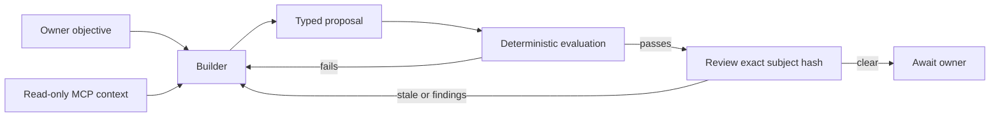

# One proposal, inspectable evidence

The owner sets the objective. A builder reads the fixture inventory and policy
through MCP, then produces a typed proposal. A deterministic evaluator validates
schema, stock, replay behaviour and snapshot freshness. Review concerns the
exact normalized proposal, inventory and ruleset identified by SHA-256.

The checked failure is cumulative allocation. A naive check sees a request for
six units and another for five, compares each to eight and approves both. This
implementation counts all outbound requests against the initial source stock.
It deliberately does not depend on transfer order or reuse incoming stock.

Identical request IDs with identical payloads are replays. Reusing an ID for a
different payload invalidates the proposal. The snapshot includes prior applied
requests, so replay handling can also be demonstrated across batches. The
example is pure: no inventory is actually updated and no ledger is persisted.

An invalid proposal exposes violations and no partially applied stock result.
Changing the proposal, snapshot or ruleset changes its review subject. Review
cannot override a failed evaluation. Every path returns executionAllowed=false.

## Review worker design

The reviewer gets the same source data and exact subject hash, with its own
instructions and read-only tools. It should inspect arithmetic, missing cases
and claim boundaries instead of merely repeating the test result. A producer
and reviewer with the same declared identity are rejected by the demonstration.

In an actual service, identities must come from authenticated principals, review
jobs must be durable and pinned to immutable revisions, and execution requires
an independently checked owner grant. Those properties cannot be created by
writing a different name into local JSON. This repository deliberately stops
before authorization and execution. See LIMITS.md.

## Operational layer

The example cron entry runs the same finite verification command as a human.
It is disabled and has not been installed. A real scheduler should record run
identity, timeout, failure and last success; a wake-up signal must not become
the only place the work exists. No recurring agent or spending loop is included.
